# 基于机器学习与 Transformer 的 EEG 表征学习与运动想象分类

**EEG Representation Learning and Motor Imagery Classification Using Machine Learning and Transformers**

**课程**　华中科技大学《数据挖掘 2026》\
**项目**　Project 3 — AI4Science：数字孪生脑与脑机接口（BCI）\
**小组成员**　邓泽林、许亦然、万志伟

## 摘要

本项目在 BCI Competition IV Dataset 2a 上比较空间特征工程与深度表征学习的跨 Session 运动想象分类性能。对 9 名受试者分别建模，统一采用 22 通道 EEG、8–30 Hz 带通滤波及相对运动想象提示的 4 秒时间窗。第一场 Session 用于训练和验证，第二场 Session 用于测试。CSP + LDA 的平均 Accuracy 和 Macro-F1 分别为 60.57% 和 57.29%，在四种方法中最高。CSP + SVM 分别为 54.24% 和 50.40%，EEGNet 为 44.79% 和 41.31%，Light Transformer 为 51.35% 和 49.01%。Light Transformer 相对 EEGNet 的两项均值分别提升 6.56 和 7.69 个百分点，但两项指标同时提升的只有 5 名受试者。EEGNet 的逐通道 Z-score、训练 Session 重拟合（Refit）及两者组合均未提高九人平均性能。两种 CSP 管线最终使用每人 288 个试次拟合，两种主实验深度模型使用 230 个试次更新参数。因此，本结果支持在当前小样本跨 Session 协议下保留 CSP + LDA 作为基线，观测到的性能差异同时反映了模型和训练方案的差别。

**关键词**　脑机接口、脑电、运动想象、公共空间模式、EEGNet、Transformer、跨 Session 泛化

## 1. Introduction

脑机接口（Brain–Computer Interface, BCI）利用神经活动建立人与外部设备之间的控制通道。头皮脑电（Electroencephalography, EEG）能够以非侵入方式连续记录脑活动。运动想象（Motor Imagery, MI）要求受试者根据提示想象动作而不实际执行，解码器可利用感觉运动节律的变化推断想象类别。这类解码为将脑信号转换成控制指令提供了基础，同时也面临信号弱、个体差异大、不同记录时段的数据分布可能变化等问题。[1]

本项目延续中期汇报确定的技术路线，研究同一人在一次校准后，模型能否识别另一次记录中的左手、右手、双脚和舌头运动想象。研究关注两个问题。一是以空间投影和带内功率为基础的传统特征工程，与直接从试次中学习表征的深度模型，哪类方法在当前跨 Session 协议下得分更高。二是在卷积前端上加入时序自注意力后，性能能否在不同受试者上稳定改善，以及改善是否与额外复杂度相称。

本项目以 EEG 解码为数字孪生脑与 BCI 课程主题的切入点，工作范围限于离线的同人跨 Session 解码。项目的贡献是建立统一的预处理、数据划分和试次级评价流程，实现并比较 CSP + LDA、CSP + SVM、EEGNet 和 Light Transformer，并用混淆矩阵、训练日志及 EEGNet 补充实验解释实测结果。

## 2. Related Work

公共空间模式（Common Spatial Patterns, CSP）通过学习多通道 EEG 的空间投影，使不同类别在投影后的方差或功率上更容易区分。Ramoser 等将 CSP 用于左右手运动想象的单试次解码 [2]。Grosse-Wentrup 和 Buss 进一步从信息论角度讨论了多分类 CSP、协方差矩阵近似联合对角化和分量选择 [3]。CSP 将高维试次压缩为少量带内空间功率特征，适合与低维特征空间上的分类器配合。

Lawhern 等提出 EEGNet，将时间卷积、逐深度空间卷积和深度可分离卷积组合为紧凑的 EEG 分类网络 [4]。时间和空间卷积分开建模，保留了脑电处理中常见的时间滤波与电极组合思路，并将特征提取和分类放在同一训练目标下。

Transformer 的自注意力能直接建立不同序列位置之间的联系 [5]。EEG-Deformer 将卷积与注意力结合，并通过层级式粗到细时序建模和密集信息提纯处理多个时间尺度 [6]。本项目取其卷积与注意力结合的思路，以固定长度的时间 token 和标准 Transformer Encoder 搭建轻量模型。

EEG 预训练工作则尝试利用多来源数据学习可迁移表征。LaBraM（ICLR 2024）先将 EEG 通道片段映射为离散编码，再预测被掩蔽的片段编码 [7]。EEGPT（NeurIPS 2024）采用基于掩蔽的自监督目标与时空表征对齐 [8]。CBraMod（ICLR 2025）通过并行的空间、时间注意力分别建模两种依赖，并以掩蔽 EEG 重建进行预训练 [9]。这些工作为后续迁移学习提供研究背景。本项目的深度模型按受试者从头进行监督训练。

## 3. Dataset & Preprocessing

### 3.1 数据集与试次定义

BCI Competition IV Dataset 2a 由 9 名受试者在不同日期各完成两场提示式运动想象记录。本项目通过 MOABB 的 `BNCI2014_001` 读取数据。每场含 6 个 Run，每个 Run 有 48 个试次，每场共 288 个试次、每类 72 个。两场合计每人 576 个试次，九人合计 5,184 个试次。记录采样率为 250 Hz，分类输入保留全部 22 个头皮 EEG 通道，包括 C3、Cz、C4，3 个眼电（EOG）通道和刺激触发通道均排除在输入之外。[1, 10]

四类依次为左手（`left_hand`）、右手（`right_hand`）、双脚（`feet`）和舌头（`tongue`）。项目将 MOABB 事件码 1–4 映射为分类标签 0–3。共享加载器逐 Run 核对 `STI` 试次开始触发与运动想象 Cue 的类别一致性，并验证 Cue 比开始触发晚 2 秒，即 500 个采样点。以 Cue 为零点截取左闭右开的 `[0, 4)` 秒区间，最后一个采样点相对 Cue 位于 3.996 秒。每个试次包含 1,000 个采样点，输出数组形状为 `(trials, 22, 1000)`。原始数组以 V 存储，主实验的深度模型将其换算为 µV 并使用 `float32`。

### 3.2 固定滤波、划分与防止泄漏

MNE 对每个 Run 的连续 EEG 独立施加 8–30 Hz 零相位 FIR 带通滤波，再截取试次。滤波器采用 Hamming 窗、`firwin` 设计和 `reflect_limited` 边界填充，低端与高端过渡带分别为 2 Hz 和 7.5 Hz，长度为 413 个系数。该通带覆盖运动想象常用的感觉运动 μ、β 节律。滤波参数预先固定，各 Run 独立处理，代码检查试次两侧是否具备足够的 FIR 支持，并确保相邻试次的滤波输入范围互不重叠。共记录 488 个数据源伪迹标记，所有带标记的试次均保留。原始 EEG 和截取试次的完整性检查均未发现 NaN 或 Inf。

每人只用 `0train` 进行开发，按类别分层划分约 80% 训练和 20% 验证，随机种子为 42。每人对应 230 个训练、58 个验证及 288 个 `1test` 测试试次，九人分别为 2,070、522、2,592 个。将完整的第二场 Session 留作测试，是为了估计同一受试者从首次校准迁移到另一场记录的表现。随机混合两场再划分会让模型在训练阶段接触测试场次的信号条件，改变这个问题的评价目标。

参数选择、checkpoint 选择和从数据估计的预处理统计量都仅使用 `0train`。验证阶段的 CSP 和特征缩放器在 230 个训练试次上拟合，选参之后的重拟合仍限定于 `0train`。深度模型的 BatchNorm 运行统计量只随训练批次更新，验证和测试均在评估模式下运行。补充实验的 Z-score 以对应拟合阶段的训练试次估计统计量，并将它们原样应用于测试数据。测试 Session 的标签用于最终评价及数据完整性与类别计数核对，训练波形和功率谱仅使用训练集。

### 3.3 数据可视化

图 1 展示 S01 的一个舌头运动想象训练试次，验证 Cue 对齐后的时间轴和 µV 量级，也显示三个中央电极的振幅随时间变化。图 2 对 S01 各类别训练试次的 C3、Cz、C4 使用 2 秒 Hann 窗和 50% 重叠的 Welch 方法估计平均功率谱。四类均在通带内保留较多能量，带外明显衰减。三通道平均后的谱线大部分接近，保留跨通道关系的空间特征可以进一步检查这类平均所省略的信息。图 3 显示四类总体各 1,296 个试次，测试子集各有 648 个，说明整体指标差异不能用测试类频率失衡解释。

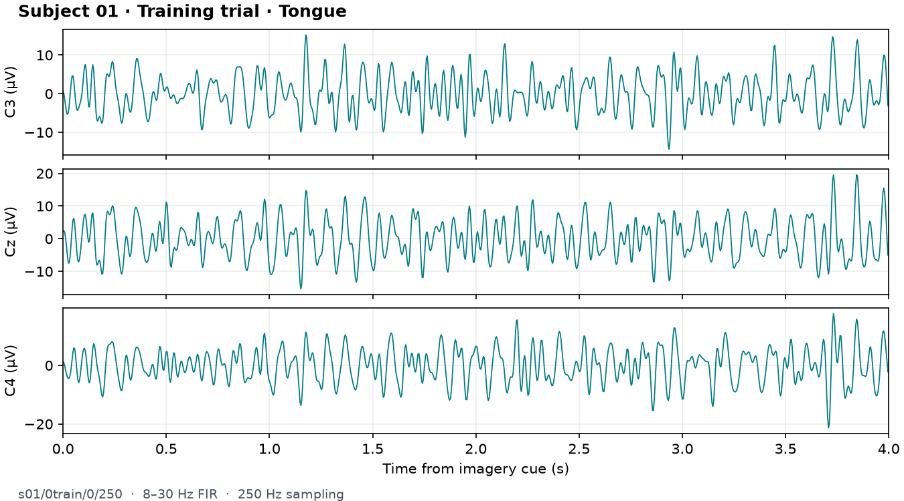\
*图 1. S01 舌头运动想象训练试次的滤波后波形。*

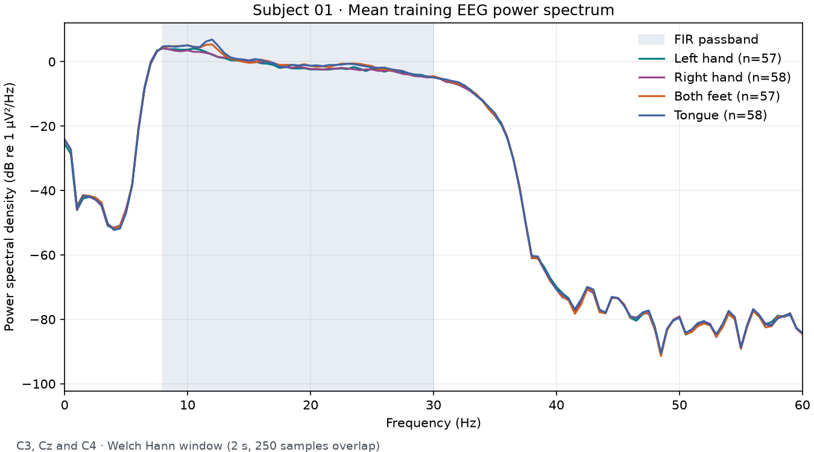\
*图 2. S01 的训练集平均 Welch 功率谱，阴影为 FIR 通带。*

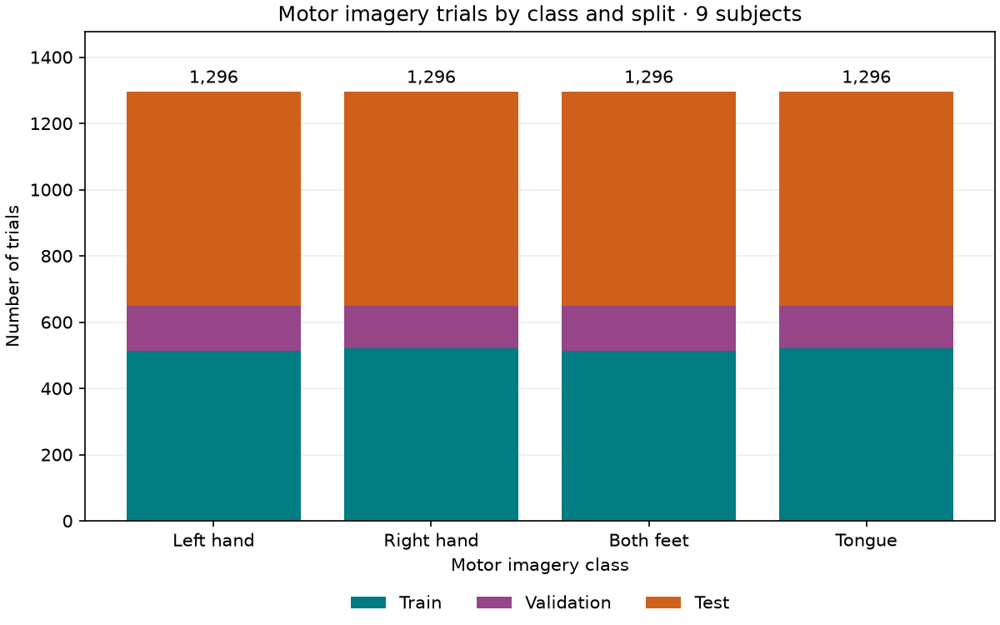\
*图 3. 九名受试者的训练、验证和测试类别分布。*

## 4. Methods

### 4.1 CSP + LDA

设单个试次 $X_i\in\mathbb{R}^{C\times T}$，其中 $C=22$、$T=1000$，$i$ 为试次索引。空间滤波器 $\mathbf w_j\in\mathbb{R}^{C}$ 将试次投影为第 $j$ 个分量的时序 $z_{ij}=\mathbf w_j^\top X_i$。以二分类为例，若 $\Sigma_a,\Sigma_b$ 为两类 EEG 的协方差估计，CSP 可通过如下准则寻找对类别 $a$ 相对功率较高的投影。[2]

$$
\max_{\mathbf w\ne\mathbf 0}
\frac{\mathbf w^\top\Sigma_a\mathbf w}
     {\mathbf w^\top(\Sigma_a+\Sigma_b)\mathbf w}.
$$

实际实验使用 MNE 的四分类 CSP，通过近似联合对角化对四类协方差求取空间滤波器。保留 $m$ 个分量后，对时序的平方值取时间平均再取自然对数，得到一个 $m$ 维特征向量。这里 $z_{ij,t}$ 表示分量 $j$ 在采样点 $t$ 的值。[3]

$$
f_{ij}=\log\left(\frac{1}{T}\sum_{t=1}^{T}z_{ij,t}^{\,2}\right),\qquad
j=1,\ldots,m .
$$

线性判别分析（Linear Discriminant Analysis, LDA）直接接收这些对数平均功率特征，利用类别均值和共享的类内协方差结构形成线性判别规则，输出四类之一。候选 $m$ 按配置顺序为 8、4、12。每个候选在训练集拟合，以验证 Macro-F1 选择最优值，同分时取先出现的候选。选定分量数后，对每名受试者用 `0train` 的全部 288 个试次重新拟合 CSP 与 LDA。[11]

### 4.2 CSP + SVM

支持向量机（Support Vector Machine, SVM）管线沿用上述 CSP 特征提取，在特征与分类器之间加入 `StandardScaler`，对每个 CSP 特征按训练数据的均值和标准差进行缩放。分类器为 scikit-learn 的 `SVC`，比较 linear 和 RBF 两种核，惩罚参数 $C_{\mathrm{SVM}}\in\{1,10\}$，RBF 使用 `gamma="scale"`。与三个 CSP 分量数合计形成 12 个候选。选择规则沿用验证 Macro-F1 和候选顺序，之后在完整 `0train` 上重新拟合 CSP、缩放器和 SVM。LDA 与 SVM 共同构成基于空间功率特征的传统基线，也用于比较同类特征提取流程下不同分类管线的表现。[12]

### 4.3 EEGNet 与共享深度模型训练策略

EEGNet 采用 Braindecode 2.0.0 的实现 [4]。该版本的默认结构先用 8 个长度为 64 的时间卷积核学习局部时域特征，随后用逐深度空间卷积为每个时间滤波器学习 2 个覆盖 22 个电极的空间投影。后续深度可分离卷积以长度 16 的逐通道时间卷积和 $1\times1$ 逐点卷积整合特征。结构中使用 BatchNorm、ELU、平均池化和 Dropout（0.25）。实验显式启用带最大范数约束的线性分类层，输出四个 logits，共有 3,444 个可训练参数。 [Braindecode 2.0 EEGNet 文档](https://braindecode.org/stable/generated/braindecode.models.EEGNet.html)

EEGNet 与 Light Transformer 均采用 Adam，学习率为 0.001，批大小为 32，每人训练上限为 100 轮。设一个批次含 $B$ 个试次，$u_{ik}$ 是模型为试次 $i$ 输出的第 $k$ 类 logit，$y_i\in\{0,1,2,3\}$ 是真实标签。优化目标为批次平均多分类交叉熵。

$$
\mathcal L=-\frac{1}{B}\sum_{i=1}^{B}
\log\left(\frac{\exp(u_{i,y_i})}{\sum_{k=0}^{3}\exp(u_{ik})}\right).
$$

每人为模型初始化和训练批次洗牌使用种子 42。每轮在 230 个训练试次上更新权重，再在 58 个验证试次上计算交叉熵和 Accuracy。保存验证交叉熵最低的 checkpoint，同值时保留较早轮次，连续 15 轮未改善则早停。最终恢复最佳 checkpoint，对测试试次取最大 logit 对应的类别。主实验中，两种深度模型的最终权重均由 230 个训练试次更新得到。

### 4.4 Light Transformer

Light Transformer 由本组在 EEG-Deformer 的卷积与注意力结合思路上实现 [6]。卷积前端沿用时间与空间分开建模的思路，后端使用标准自注意力在不同时间位置之间交换信息 [5]。与 EEGNet 用可分离卷积整合局部特征的方案相比，Light Transformer 让每个时间 token 有机会利用同一试次内较远位置的证据。表 1 给出前向过程，其中 $B$ 为批大小。

*表 1. Light Transformer 的结构与张量形状。*

| 阶段 | 实现 | 输出形状 |
| --- | --- | --- |
| 输入 | 22 EEG 通道，1,000 个采样点 | $B\times22\times1000$ |
| 时间卷积 | 16 个 $1\times25$ 卷积核，同长填充，随后 BatchNorm | $B\times16\times22\times1000$ |
| 空间卷积 | 分组逐深度 $22\times1$ 卷积，倍增系数 2，随后 BatchNorm 和 ELU | $B\times32\times1\times1000$ |
| Token 化 | 时间平均池化窗口和步长均为 25，线性投影至 64 维，加可学习位置编码及 Dropout | $B\times40\times64$ |
| Transformer Encoder | 2 层，4 个注意力头，前馈层维度 128，GELU，Pre-LayerNorm，末层 LayerNorm | $B\times40\times64$ |
| 分类头 | 沿 token 维全局平均，再线性映射到四类 | $B\times4$ |

长度为 25 个采样点的池化将 4 秒试次压缩为 40 个时间 token，每个池化窗口对应 100 ms。位置编码后的 Dropout 与 Encoder 的 Dropout 均为 0.2，总计 73,204 个可训练参数。该设计以固定粒度降低时序注意力的输入长度，但时间平均可能弱化短暂变化，额外参数也增加了数据有限时的估计负担。由于课程实现采用单一粒度 token 和标准 Encoder，其实证结果只对应本项目的轻量架构。完整 EEG-Deformer 的层级模块和密集信息提纯模块未在本项目中实现。

## 5. Experiments & Results

### 5.1 实验环境与指标

正式运行日志记录 Python 3.12.3、MOABB 1.7.2、MNE 1.13.2 和 scikit-learn 1.9.1。CSP 基线的 BLAS 线程数限制为 1。深度模型正式实验使用 NVIDIA GeForce RTX 4090，PyTorch 2.13.0+cu130、CUDA 13.0、cuDNN 9.20.0，并启用 PyTorch 确定性算法。两种网络共享第 4.3 节的训练超参数，逐人复用相同的测试试次。四模型比较采用原始 EEGNet Baseline。

对每名受试者的 $N=288$ 个测试试次，设 $y_i$、$\hat y_i$ 为真实与预测标签，$\mathbf 1\{\cdot\}$ 为指示函数。Accuracy 衡量总体正确比例，四类均衡时均匀随机猜测的期望 Accuracy 为 25%。Macro-F1 对四类 F1 等权平均，$TP_k$、$FP_k$、$FN_k$ 分别是第 $k$ 类的真阳性、假阳性和假阴性计数，分母为零时该类 F1 记为 0。

$$
\mathrm{Accuracy}=\frac{1}{N}\sum_{i=1}^{N}\mathbf 1\{\hat y_i=y_i\},
\qquad
\mathrm{Macro\text{-}F1}=\frac{1}{4}\sum_{k=0}^{3}
\frac{2TP_k}{2TP_k+FP_k+FN_k}.
$$

混淆矩阵以真实类别为行、预测类别为列，按左手、右手、双脚、舌头固定顺序记录试次数。模型汇总对 9 名受试者等权，标准差采用总体口径（`ddof=0`），反映受试者间离散程度。测试成绩取自本项目保存的逐试次预测和逐受试者汇总，以百分数换算后显示至小数点后四位。

### 5.2 九人测试表现

*表 2. 逐受试者测试成绩。每格依次为 Accuracy / Macro-F1，单位均为 %。*

| 受试者 | CSP + LDA | CSP + SVM | EEGNet | Light Transformer |
| --- | ---: | ---: | ---: | ---: |
| S01 | 68.4028 / 67.7466 | 65.9722 / 63.6879 | 40.9722 / 34.6506 | 60.0694 / 57.8116 |
| S02 | 53.4722 / 48.5757 | 51.0417 / 45.9059 | 26.0417 / 17.8049 | 40.2778 / 40.5631 |
| S03 | 70.1389 / 67.6446 | 63.8889 / 63.4226 | 87.8472 / 87.6378 | 72.9167 / 70.2409 |
| S04 | 58.6806 / 53.8466 | 48.6111 / 46.2351 | 38.5417 / 38.0346 | 42.0139 / 34.5806 |
| S05 | 37.1528 / 32.1715 | 31.5972 / 23.8898 | 26.7361 / 20.1095 | 36.8056 / 31.7679 |
| S06 | 46.1806 / 44.0517 | 42.7083 / 39.6193 | 38.5417 / 36.8895 | 36.8056 / 37.4037 |
| S07 | 59.7222 / 52.6686 | 48.6111 / 38.1932 | 36.8056 / 35.1470 | 47.9167 / 45.5710 |
| S08 | 76.7361 / 76.2963 | 71.8750 / 71.4750 | 28.8194 / 22.7588 | 64.9306 / 64.7937 |
| S09 | 74.6528 / 72.5907 | 63.8889 / 61.1492 | 78.8194 / 78.7920 | 60.4167 / 58.3297 |

*表 3. 九名受试者的测试均值 ± 总体标准差。均值以 % 表示，标准差以百分点表示。*

| 模型 | 人数 | Accuracy | Macro-F1 |
| --- | ---: | ---: | ---: |
| CSP + LDA | 9 | **60.5710 ± 12.5728** | **57.2880 ± 13.8534** |
| CSP + SVM | 9 | 54.2438 ± 12.2661 | 50.3976 ± 14.5733 |
| EEGNet | 9 | 44.7917 ± 21.3459 | 41.3139 ± 23.5934 |
| Light Transformer | 9 | 51.3503 ± 12.7035 | 49.0069 ± 13.2815 |

图 4 和图 5 展示两个指标在受试者间的变化。CSP + LDA 在 7 人上同时取得四模型最高的 Accuracy 和 Macro-F1，并在 9 人上均优于 CSP + SVM。其九人均值比 CSP + SVM 高 6.33 和 6.89 个百分点。EEGNet 在 S03、S09 的两项成绩居首，在 S02、S05、S08 的 Accuracy 仅约 26%–29%。EEGNet 的 Accuracy 标准差达 21.35 个百分点，S08 上两条 CSP 基线均超过 70%，说明该受试者的低分主要出现在 EEGNet 这一模型设置下。S05 的四模型 Accuracy 均低于 38%，则呈现多条管线共同遇到的困难。

Light Transformer 的均值比 EEGNet 高 6.56 和 7.69 个百分点，两项在 S01、S02、S05、S07、S08 同时提升，其中 S08 的 Accuracy 增加 36.11 个百分点。S03、S09 的两项指标下降，S04、S06 的 Accuracy 和 Macro-F1 变化方向相反。Light Transformer 在 S03 的两项指标都超过两条 CSP 基线，但九人平均 Accuracy 仍比 CSP + LDA 和 CSP + SVM 低 9.22 和 2.89 个百分点，Macro-F1 分别低 8.28 和 1.39 个百分点。

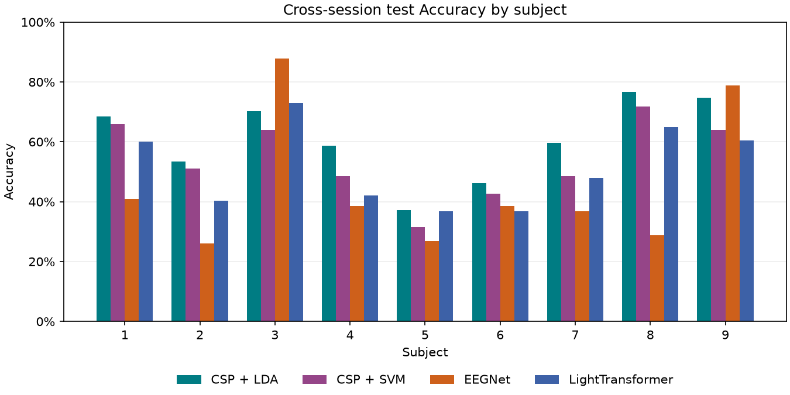\
*图 4. 四模型逐受试者测试 Accuracy。*

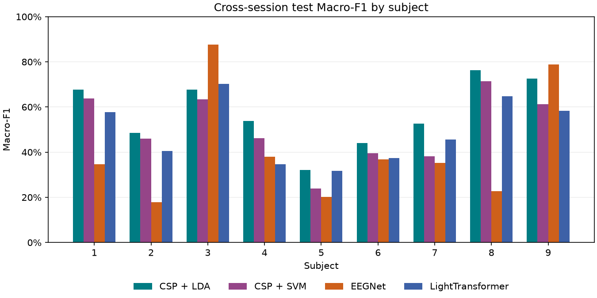\
*图 5. 四模型逐受试者测试 Macro-F1。*

### 5.3 代表性混淆矩阵

S01 的四个真实类别各有 72 个测试试次，图 6–8 使用相同的类别顺序，因此可直接比较类别错误的去向。CSP + LDA 正确识别了 63 个左手试次，把 31 个右手试次判为左手，并把 25 个双脚试次判为舌头。CSP + SVM 有 44 个双脚试次被判为舌头，对这一类别的召回低于 CSP + LDA（25/72 与 45/72）。

EEGNet 将 63 个左手试次错判为右手，右手占全部 288 个预测的 183 个（63.54%）。这使右手召回达到 72/72，而左手召回只有 5/72，也解释了 Accuracy 和 Macro-F1 的差距。Light Transformer 将左手正确数提高到 43 个，右手预测回落到 67 个，但双脚有 48 个被判为舌头，双脚召回仍只有 18/72。S01 的深度模型改进主要体现在减少左手向右手的单向误判，双脚与舌头的区分仍较困难。这些错误分布限于示例受试者。

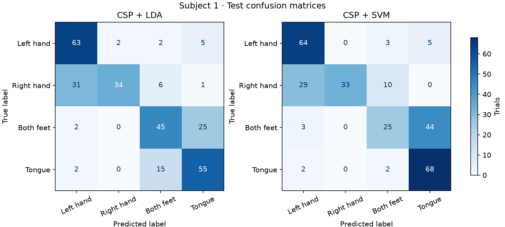\
*图 6. S01 的两条 CSP 基线测试混淆矩阵。*

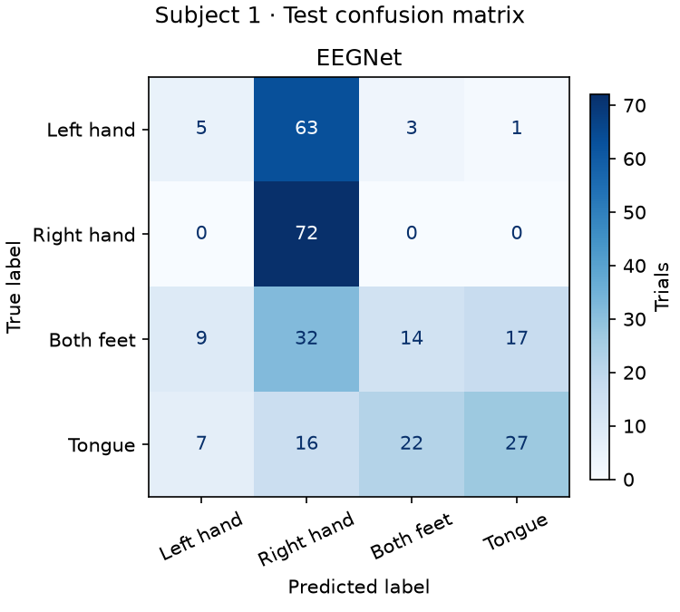\
*图 7. S01 的 EEGNet 测试混淆矩阵。*

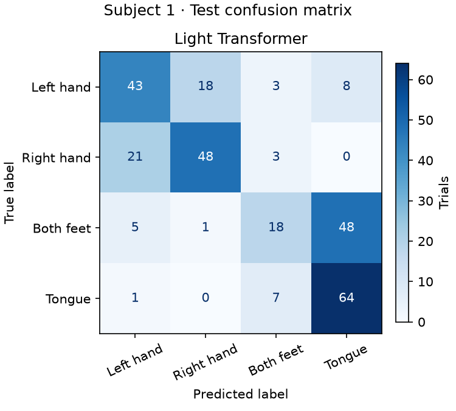\
*图 8. S01 的 Light Transformer 测试混淆矩阵。*

### 5.4 训练曲线与早停

图 9 和图 10 的虚线分别标出 S01 两种网络验证交叉熵最低的轮次。EEGNet 从最佳第 13 轮到停止的第 28 轮，训练 Loss 从 0.876 降至 0.618，验证 Loss 从 1.219 升至 1.336。Light Transformer 从最佳第 12 轮到停止的第 27 轮，训练 Loss 从 0.751 降至 0.391，验证 Loss 从 0.868 升至 0.994。两者在继续拟合训练集时，对同一 Session 留出的验证试次表现反而下降，显示出过拟合迹象。恢复最佳验证 checkpoint 可避免直接使用后续已经退化的权重。九人中 EEGNet 有 7 人触发早停，S03 与 S09 达到 100 轮，Light Transformer 有 9 人触发早停。验证集仍来自 `0train`，这些曲线无法单独量化跨 Session 分布变化对测试成绩的贡献。

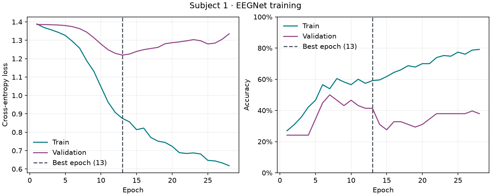\
*图 9. S01 的 EEGNet 训练与验证 Loss、Accuracy。*

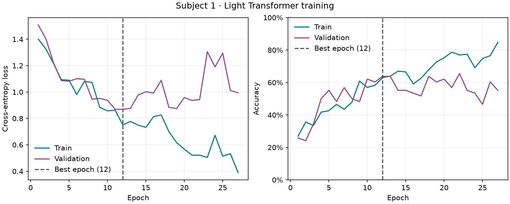\
*图 10. S01 的 Light Transformer 训练与验证 Loss、Accuracy。*

### 5.5 EEGNet 补充实验

补充实验检查逐通道标准化和完整训练 Session 重拟合能否改善 EEGNet。用 $x^{(\mu\mathrm V)}_{i,c,t}$ 表示换算为 µV 的试次 $i$、通道 $c$、采样点 $t$ 的值。对每个通道，使用当前拟合所用的试次，沿试次和时间两轴计算总体均值 $\mu_c$ 与总体标准差 $\sigma_c$，再得到无量纲的标准化值 $\tilde x_{i,c,t}$，计算后转为 `float32`。

$$
\tilde x_{i,c,t}=
\frac{x^{(\mu\mathrm V)}_{i,c,t}-\mu_c}{\sigma_c+\varepsilon},
\qquad \varepsilon=10^{-6}\,\mu\mathrm V .
$$

Refit 使用在原 230/58 划分上选得的最佳轮次。它以种子 42 重新初始化网络、Adam 和批次洗牌，在 `0train` 的 288 个试次上训练到固定轮数。两种 Refit 分别沿用相应输入设置的最佳轮次。组合组在完整 `0train` 重新计算标准化统计量，并使用该统计量转换重拟合和最终测试输入。三种新增设置沿用原网络和训练配置，完成每人的全部训练后统一评估测试 Session。Baseline 直接复用原主实验结果。

*表 4. EEGNet 补充实验的设置和九人测试结果。均值以 % 表示，标准差以百分点表示。*

| 设置 | 输入及标准化统计量 | 最终训练方式 | Accuracy | Macro-F1 |
| --- | --- | --- | ---: | ---: |
| Baseline | µV，直接输入 | 230 个试次，原最佳验证 checkpoint | 44.7917 ± 21.3459 | 41.3139 ± 23.5934 |
| Z-score | 230 个试次拟合逐通道统计量 | 230 个试次，最佳验证 checkpoint | 34.4522 ± 15.3214 | 27.5497 ± 19.0889 |
| Refit | µV，直接输入 | 288 个试次，从头训练至 Baseline 最佳轮次 | 41.4738 ± 22.8564 | 34.4978 ± 26.8269 |
| Z-score + Refit | 选轮时用 230 个试次，重拟合时重新用 288 个试次估计 | 288 个试次，从头训练至 Z-score 最佳轮次 | 33.7963 ± 17.1109 | 24.8378 ± 21.4195 |

相对 Baseline，三种变体的平均 Accuracy 分别下降 10.34、3.32 和 11.00 个百分点，平均 Macro-F1 分别下降 13.76、6.82 和 16.48 个百分点。图 11 对比四组的平均 Accuracy。S03 在 Z-score 组将 288 个试次全部预测为左手，Accuracy 从 87.85% 降到 25.00%，Macro-F1 为 10.00%。训练记录显示，该组首批损失和梯度检查通过，并发生了参数更新。Refit 则在 S02、S04、S09 同时提高两项指标，整体均值下降。

逐通道缩放改变了网络输入的各通道相对幅度，在既有模型和优化设置下可能改变原本有用的功率关系或训练动态。Refit 固定 Epoch 数，训练试次从 230 增至 288 后，每轮批次数从 8 变为 9，样本数量与梯度更新次数同时改变。在固定配置、单一种子且复用已评估过的测试 Session 的条件下，这些结果仅用于探索当前实现的行为。

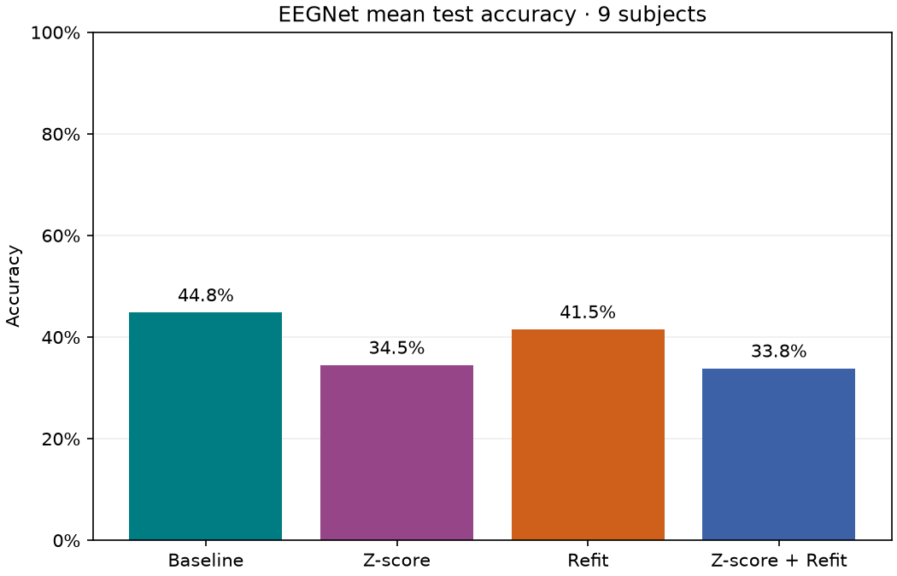\
*图 11. EEGNet Baseline、Z-score、Refit 与组合设置的九人平均测试 Accuracy。*

### 5.6 参数量与耗时

*表 5. 正式九人运行的模型复杂度与耗时。*

| 模型 | 可训练参数 | 平均训练轮次 | 平均训练阶段（秒/人） | 平均端到端（秒/人） | 九人端到端合计（秒） |
| --- | ---: | ---: | ---: | ---: | ---: |
| EEGNet | 3,444 | 50.22 | 未单独记录 | 9.82 | 88.39 |
| Light Transformer | 73,204 | 32.22 | 3.67 | 9.08 | 81.73 |

两种网络均在 RTX 4090 上计时。训练阶段口径包含训练、验证循环以及 checkpoint 的写入与恢复。端到端按受试者记录，涵盖数据加载至测试评估、日志输出及示例绘图。Light Transformer 的参数量为 EEGNet 的约 21.3 倍，但平均端到端耗时少 0.74 秒，且平均训练轮次较少。结合 EEGNet 缺少独立训练阶段计时，这组记录只支持比较本次运行的端到端耗时。CSP 日志没有可对齐的耗时记录，传统管线的空间滤波器和分类器系数也未按神经网络参数量口径统计，因此四模型的成本排序无法由本次日志给出。

## 6. Discussion

### 6.1 小样本下的空间特征与受试者差异

CSP + LDA 的优势与其特征约束相符。固定 8–30 Hz 通带后，CSP 直接围绕类别协方差拟合空间投影，选出的 LDA 输入维度为 8 或 12，分类器只需在少量对数功率特征上估计线性边界。用每人几百个试次学习时，这种归纳偏置有可能保留有用的感觉运动节律信息，并减少分类器需要估计的参数。CSP + SVM 同样使用 CSP，但增加了特征缩放、核函数及惩罚参数选择。在 58 个验证试次上选择更大的候选集合时，最优配置可能对验证样本波动更敏感。两条管线还可选择不同的 CSP 分量数，因此现有结果不足以把差距归因于分类器或核函数本身。

EEGNet 在 S03、S09 上的高分说明其端到端表示在部分受试者上能有效区分运动想象。S02、S05、S08 的低 Accuracy 和更低的 Macro-F1 则说明类别识别质量不均衡，S01 的预测分布进一步给出了具体的类别偏向。有限的个体训练数据可能使时空卷积学习到只适用于当次记录的模式，隔日记录中的电极接触、信号幅度或受试者状态变化也可能降低迁移效果。现有结果没有独立操纵这些因素，也没有量化各人的跨 Session 分布漂移。S08 的模型间悬殊差距和 S05 的共同低分提示，受试者差异应结合模型逐人分析，单一平均值无法表述校准后的可靠性。

### 6.2 自注意力带来的改善与成本

Light Transformer 在相同训练试次量和早停规则下提高了深度模型的平均得分，并缩小了 EEGNet 的受试者间波动。卷积前端配合短 token 序列，可能使模型更容易整合同一试次内不同时间段的证据，但两模型也同时在卷积结构、池化方式、位置编码、分类头和参数量上存在差别。实验没有在同一卷积架构上单独控制注意力模块，因此无法将均值提升归因于注意力本身。S03、S09 的回落和 S01 的双脚误判也表明，改善随受试者与类别而异。

就本次数据而言，额外参数换来了相对于 EEGNet 的均值改进，最高的九人均值仍来自 CSP + LDA。若主要目标是当前协议下的跨 Session 得分，现有证据支持优先考虑传统基线。若研究重点是从试次学习时序表征，Light Transformer 提供了可继续验证的结构。在获得同口径的单轮、推理和多次运行计时之前，端到端耗时的小幅差异不足以判定架构效率。

### 6.3 实验局限

1. **最终拟合样本量不同。** 四模型共用相同的开发划分及 288 个测试试次。CSP + LDA 和 CSP + SVM 在超参数选定后以全部 288 个 `0train` 试次重拟合，EEGNet 和 Light Transformer 的主实验 checkpoint 来自 230 个更新权重的试次，另外 58 个只用于验证。CSP 的样本量优势可能影响排序。EEGNet Refit 同时改变了有效数据量和更新步数，只是一种探索性对照。
2. **受试者、Session 和随机性覆盖有限。** 9 人均采用同一方向的 Session 迁移和种子 42。受试者间标准差是描述性指标，无法代表同一受试者在多次初始化下的训练波动。报告不据此主张统计显著性，结果也不直接支持对新受试者或其他数据集的泛化结论。
3. **验证与实际使用环境仍有距离。** 同场验证可发现部分过拟合，但未模拟隔日分布变化。补充实验复用历史上已评估的测试 Session，其结论限于探索性分析。数据源伪迹试次保留，实验未针对伪迹比例分层评价。离线零相位滤波需要窗两侧的信号上下文，当前结果对应已知 Cue 的离线解码。

## 7. Conclusion & Future Work

本项目在统一的 EEG 数据处理及跨 Session 测试流程下，完成了九名受试者、四个类别、四种模型的比较。CSP + LDA 以 60.57% 的平均 Accuracy 和 57.29% 的平均 Macro-F1 取得本实验最高成绩。Light Transformer 改善了 EEGNet 的平均表现，但受试者层面的改进不一致，增加模型复杂度未带来稳定收益。EEGNet 的三种补充设置均未提高九人均值。当前的模型排序应结合最终拟合样本量差异和单种子设置解释。

后续可先为各模型统一最终拟合样本量和训练预算，并在多个随机种子、多个场次方向上重复实验，按受试者报告配对差异、置信区间和统计检验。进一步可扩大训练数据，验证只在训练集实施的数据增强和更合适的正则化或训练策略，检验模型对新 Session 的鲁棒性。跨受试者场景可采用留一受试者验证。也可在严格核对目标测试数据隔离的前提下，比较 EEGPT、LaBraM 或 CBraMod 的预训练表征迁移、从头训练及传统基线。

## 8. Contributions & References

### 8.1 Contributions

**邓泽林（数据处理与项目整合）**　负责 BCI Competition IV 2a 的数据获取与理解、EEG 预处理、事件对齐与时间窗提取、训练验证测试划分、数据质量检查及基础可视化，并参与整体实验协议设计、结果整理和报告整合。

**许亦然（传统机器学习基线与实验评价）**　负责 CSP + LDA 和 CSP + SVM 的实现、超参数选择与九名受试者实验，承担分类指标计算、混淆矩阵整理及模型结果对比，并参与结果分析和报告撰写。

**万志伟（深度学习模型与扩展实验）**　负责 EEGNet 的实现与训练、Light Transformer 的架构实现与实验、深度模型超参数设置及训练曲线和结果分析，完成 EEGNet 的 Z-score、Refit 补充实验，并参与模型复杂度比较和报告撰写。

三名成员共同参与项目讨论、报告检查和最终完善。

### 8.2 References

[1] Tangermann, M., Müller, K.-R., Aertsen, A., et al. (2012). Review of the BCI Competition IV. *Frontiers in Neuroscience*, 6, 55. [DOI: 10.3389/fnins.2012.00055](https://doi.org/10.3389/fnins.2012.00055)

[2] Ramoser, H., Müller-Gerking, J., & Pfurtscheller, G. (2000). Optimal spatial filtering of single trial EEG during imagined hand movement. *IEEE Transactions on Rehabilitation Engineering*, 8(4), 441–446. [DOI: 10.1109/86.895946](https://doi.org/10.1109/86.895946)

[3] Grosse-Wentrup, M., & Buss, M. (2008). Multiclass common spatial patterns and information theoretic feature extraction. *IEEE Transactions on Biomedical Engineering*, 55(8), 1991–2000. [DOI: 10.1109/TBME.2008.921154](https://doi.org/10.1109/TBME.2008.921154)

[4] Lawhern, V. J., Solon, A. J., Waytowich, N. R., Gordon, S. M., Hung, C. P., & Lance, B. J. (2018). EEGNet: A compact convolutional neural network for EEG-based brain–computer interfaces. *Journal of Neural Engineering*, 15(5), 056013. [DOI: 10.1088/1741-2552/aace8c](https://doi.org/10.1088/1741-2552/aace8c)

[5] Vaswani, A., Shazeer, N., Parmar, N., Uszkoreit, J., Jones, L., Gomez, A. N., Kaiser, Ł., & Polosukhin, I. (2017). Attention is all you need. *Advances in Neural Information Processing Systems*, 30. [arXiv:1706.03762](https://arxiv.org/abs/1706.03762)

[6] Ding, Y., Li, Y., Sun, H., Liu, R., Tong, C., Liu, C., Zhou, X., & Guan, C. (2025). EEG-Deformer: A dense convolutional transformer for brain-computer interfaces. *IEEE Journal of Biomedical and Health Informatics*, 29(3), 1909–1918. [DOI: 10.1109/JBHI.2024.3504604](https://doi.org/10.1109/JBHI.2024.3504604)

[7] Jiang, W.-B., Zhao, L.-M., & Lu, B.-L. (2024). Large brain model for learning generic representations with tremendous EEG data in BCI. *International Conference on Learning Representations (ICLR)*. [arXiv:2405.18765](https://arxiv.org/abs/2405.18765)

[8] Wang, G., Liu, W., He, Y., Xu, C., Ma, L., & Li, H. (2024). EEGPT: Pretrained transformer for universal and reliable representation of EEG signals. *Advances in Neural Information Processing Systems*, 37. [DOI: 10.52202/079017-1239](https://doi.org/10.52202/079017-1239) · [会议论文](https://proceedings.neurips.cc/paper_files/paper/2024/file/4540d267eeec4e5dbd9dae9448f0b739-Paper-Conference.pdf)

[9] Wang, J., Zhao, S., Luo, Z., Zhou, Y., Jiang, H., Li, S., Li, T., & Pan, G. (2025). CBraMod: A criss-cross brain foundation model for EEG decoding. *International Conference on Learning Representations (ICLR)*. [arXiv:2412.07236](https://arxiv.org/abs/2412.07236)

[10] Brunner, C., Leeb, R., Müller-Putz, G. R., Schlögl, A., & Pfurtscheller, G. (2008). BCI Competition 2008 — Graz data set A. *BCI Competition IV Dataset 2a* 数据说明. [官方数据说明](https://www.bbci.de/competition/IV/desc_2a.pdf)

[11] Fisher, R. A. (1936). The use of multiple measurements in taxonomic problems. *Annals of Eugenics*, 7, 179–188. [DOI: 10.1111/j.1469-1809.1936.tb02137.x](https://doi.org/10.1111/j.1469-1809.1936.tb02137.x)

[12] Cortes, C., & Vapnik, V. (1995). Support-vector networks. *Machine Learning*, 20, 273–297. [DOI: 10.1007/BF00994018](https://doi.org/10.1007/BF00994018)
